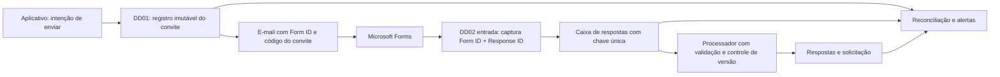

# Estratégia de resiliência do envio e processamento da Due Diligence

**Implementação preparada em 21/10/2026:** consulte
[IMPLANTAR_RESILIENCIA_DD01_DD02.md](IMPLANTAR_RESILIENCIA_DD01_DD02.md).
A versão entregue mantém o aplicativo como gerador do código de envio; o DD01
cria o registro imutável do convite antes de mandar o e-mail. O DD02 captura
o Forms numa Inbox; o DD02P processa uma linha por vez e usa ETag no item
principal. Cada mudança do e-mail do terceiro cria uma nova
`forms_destinatario_versao_id`; o DD02P exige que ela coincida com a versão
registrada no convite, impedindo que um link A volte a valer após A → B → A.
Esse processador serial dispensa, nesta versão, o bloqueio com
prazo de expiração descrito como evolução abaixo. A reconciliação completa
Forms × Inbox ainda exige export do Forms, pois o conector disponível não
oferece listagem retroativa das respostas neste fluxo.

Análise em 20/10/2026 dos pacotes exportados do ambiente ativo:
`EnviarquestionárioDueDiligence_20261020221632.zip` (DD01) e
`ProcessarrespostaDueDiligence_20261020214134.zip` (DD02), do YAML do aplicativo
e dos esquemas versionados neste repositório. Não houve acesso direto à
configuração das listas nem ao inventário de fluxos ativos no ambiente.

## Diagnóstico

**A resposta 96 da solicitação 36 veio do formulário correto.** O link montado
pelo DD01 e o gatilho/`Obter detalhes da resposta` do DD02 usam o mesmo Form ID
`itUz0nOZp0OvaWdjYwVIoMoEbKAMYIZFqUAdth6B_EFURVRKSFdaVDE4Q1RIV0VTRkxFSjFZS0VEQS4u`.
O código `d79d9a11-d9e2-4a7e-8a10-1b05d9df5077` da resposta 96 pertence a
um envio anterior da solicitação 36. O código atual no item, após os reenvios,
era `71aad33a-62b4-47be-aa0e-03079d473071`. A busca do DD02 pelo código
atual, portanto, não encontrava a solicitação. A versão ativa do DD02 também
busca o código no histórico, mas depende das colunas estruturadas
`forms_envio_id` e `email_envio` ali. Elas estão na versão do DD01 exportada em
20/10, modificada em 14/10; os registros antigos exibidos do caso
36 não têm esses valores. Essa é a explicação mais forte para a falha de
correlação da resposta 96. A recuperação manual v3 foi confirmada pelo usuário,
mas não corrigiu o processamento geral.

Um outro formulário só explicaria uma resposta **sem execução** no DD02, pois
o gatilho é configurado por Form ID. Os reenvios aqui geraram links do **mesmo**
formulário com códigos diferentes. O campo `Código de acompanhamento` é um
identificador de correlação; o Forms aceitou a resposta como `anonymous`, então
o código ou o e-mail de destino não comprovam quem respondeu.

| Falha observada no pacote ativo | Efeito possível |
| --- | --- |
| DD01 envia e-mail, atualiza o item e depois grava o histórico; `Envio_Concluido` executa mesmo se o histórico falhar | Link realmente enviado sem registro estruturado para busca posterior. |
| DD02 procura envio antigo por `forms_envio_id`, usa `greater(..., 0)` e `first(...)` | Código duplicado no histórico pode ser associado ao primeiro registro, sem exigir unicidade. |
| DD02 exige `forms_envio_processado_id = forms_envio_id` para validar envio antigo; para código atual exige que o DD01 já tenha marcado o envio | Resposta rápida durante o intervalo entre envio de e-mail e atualização do item pode falhar e ficar no Forms. |
| DD02 usa só `forms_ultima_resposta_id` para detectar repetição e grava o pai com `IF-MATCH: *` | Execuções simultâneas, cópias manuais ou mudanças de status podem sobrescrever dados mais recentes. O controle de concorrência 1 do gatilho original não protege outros fluxos. |
| DD02 grava respostas filhas enquanto consulta parâmetros, e só depois consolida o pai | Falha no meio deixa linhas parciais; o retry depende de estado implícito. |
| DD02 reescreve `forms_envio_id` do pai com o código de um link antigo aceito | A coluna deixa de significar “último envio” e passa a significar “envio da resposta”, afetando a leitura do aplicativo. |
| A galeria do aplicativo filtra respostas pelo `forms_envio_id` atual do pai | Uma resposta válida pode desaparecer da visualização se houver novo envio ou restauração de um código anterior. |
| DD02 usa `utcNow()` como `data_resposta` | Uma resposta recuperada depois aparece com data de processamento, não de submissão. |
| Os gatilhos DD01 e DD02 estão com concorrência 1 | Picos podem acumular eventos além da fila permitida pelo Power Automate; aumentar a concorrência sem idempotência também abre disputas. |
| Esquema versionado de `tb_dueDiligenceDesdobramentos` não contém `forms_envio_id` e `email_envio`; ZIPs gerados no repositório estão atrás dos exportados | Um `Update` com pacote local antigo pode retirar correções feitas no ambiente ativo. |

## Regra de negócio recomendada

**Reenvio ao mesmo e-mail enquanto a solicitação aguarda o terceiro é um
lembrete com novo link, não uma anulação automática dos links antigos.** A
primeira resposta válida recebida para qualquer envio comprovadamente
registrado dessa solicitação é candidata a processamento. As respostas
seguintes ficam registradas como duplicadas ou em revisão, sem trocar a
resposta já aceita automaticamente. Uma troca de destinatário deve revogar os
convites do destinatário anterior para processamento automático; as respostas
por links revogados entram em revisão. Solicitações canceladas ou já concluídas
também não são reabertas automaticamente.

Essa regra exige distinguir “último convite emitido”, “convite usado pela
resposta aceita” e “última resposta recebida”. Hoje o mesmo
`forms_envio_id` do item cumpre mais de um desses papéis.

## Desenho proposto

1. **Registro de envios.** Fazer o aplicativo criar a intenção em
   `tb_dueDiligenceEnvios` e o DD01 processar cada intenção. A lista deve ter
   `envio_id` obrigatório e único, `solicitacao_id`, `formulario_id`, e-mail do
   destinatário no momento do envio, data de criação, data de aceite pelo conector de e-mail,
   estado (`Preparado`, `Aceito pelo conector`, `Falha`, `Entrega incerta`,
   `Revogado`), ID da execução DD01 e motivo do reenvio. Criar o registro
   **antes** de enviar o e-mail. O gatilho de captura da intenção deve ser
   curto e idempotente, sem depender de uma única execução longa em série.
   Após o conector aceitar a mensagem, atualizar o estado; só então marcar o
   item como enviado. Se alguma atualização falhar,
   manter pendência rastreável. A confirmação do conector não prova entrega na
   caixa do terceiro. Não repetir o envio automaticamente quando o resultado
   do conector for incerto: reconciliar primeiro para evitar e-mails duplos.
   Usar o histórico narrativo para leitura humana, não como índice exclusivo.

2. **Entrada durável de respostas.** Separar o DD02 em captura e processamento.
   A captura obtém os detalhes do Forms e grava uma linha imutável em
   `tb_dueDiligenceRespostasInbox`, com chave única `Form ID|Response ID`,
   código declarado, data de submissão, data de captura, dados necessários ao
   processamento, estado e ID da execução. Se o conector não fornecer a data
   original do Forms, guardar a hora de captura com esse nome e buscar a data
   de submissão na reconciliação; não atribuir `utcNow()` à submissão. Repetir
   o mesmo evento vira duplicata inofensiva. Se o Forms ou SharePoint estiver
   indisponível, registrar/alertar a falha e reconciliar com a exportação do Forms. A captura
   não decide status ou risco.

3. **Correlação determinística.** O processador só aceita código que localize
   **exatamente um** envio do mesmo Form ID. Confirma a solicitação, estado do
   convite, status `Aguardando Terceiro` e `FLUXO III`. Para link antigo do mesmo
   destinatário, aplica a regra acima. Código ausente, desconhecido, duplicado,
   revogado, com formulário diferente ou com mudança de destinatário vai para
   `Revisão`, preservando resposta e motivo. Não correlacionar por nome, data
   ou e-mail parecido. Como o Forms é anônimo, uma política que exija
   identificação forte do terceiro requer outro canal de autenticação.

4. **Processamento retomável.** Resolver e validar todas as perguntas e
   parâmetros de risco antes de alterar listas. Adquirir um bloqueio por
   solicitação com ETag e prazo de expiração, associando-o ao `Response ID`;
   uma segunda execução aguarda ou vai para revisão. Gravar cada resposta com
   chave única `Form ID|Response ID|pergunta`; em repetição, comparar o conteúdo
   existente e tratar divergência como exceção. Registrar no pai a
   `resposta_aceita_id` e `envio_da_resposta_id` em campos separados do último
   envio. Releitura imediatamente antes da transição e atualização condicional
   por ETag impedem sobrescrever uma alteração posterior; erro 412 abre nova
   avaliação ou revisão. Não usar `IF-MATCH: *` na consolidação. SharePoint não
   fornece transação entre estas listas: após falha parcial, o processador
   retoma pelas chaves únicas e a reconciliação confere o conjunto completo.
   Guardar data real de submissão e data de processamento separadamente.

5. **Aplicativo e auditoria.** Exibir respostas pelo `resposta_aceita_id` e
   `envio_da_resposta_id`, sem filtrar pelo último código enviado. Mostrar ao
   operador os estados `Aguardando envio`, `Envio incerto`, `Resposta recebida`,
   `Em revisão` e `Processada`. Toda mudança de status deve deixar evento de
   auditoria; falha em criar evento abre pendência visível. Uma execução só é
   considerada encerrada após as condições de integridade da solicitação,
   respostas e auditoria serem satisfeitas.

6. **Reconciliação diária e alertas imediatos.** Comparar respostas existentes
   no Forms, linhas da Inbox, convites, respostas internas, pai e histórico.
   Alertar para: resposta sem captura/processamento após prazo definido;
   código sem vínculo único; envio aceito sem linha de convite; pai concluído
   sem todas as perguntas; divergência de status; erro DD01/DD02; e existência
   de mais de um fluxo ativo com o mesmo Form ID. O script
   `auditar_respostas_pendentes.py` já ajuda na conferência manual, mas depende
   de exportações e não substitui a reconciliação operacional.

## Ordem de implementação

**Primeira entrega, menor risco:** exportar e versionar os DD01/DD02 ativos;
inspecionar as colunas reais da lista; verificar se há outros gatilhos ativos
para o Form ID; levantar respostas pendentes no Forms; retroalimentar os
envios antigos **somente** após conferir código, solicitação e e-mail em fonte
confiável; corrigir o DD02 para exigir um único resultado e produzir erro
específico; alertar quando o histórico de envio falhar. Manter uma recuperação
manual por `Response ID` para pendências já existentes.

**Segunda entrega:** criar registro de envios e Inbox com chaves únicas,
processador retomável e regra explícita para links antigos/troca de e-mail.
Migrar a leitura do aplicativo para a resposta aceita. Ativar a reconciliação
periódica. Só retirar o processamento antigo após prova de que não restou
resposta sem captura nem dois fluxos consumindo o mesmo formulário.

**Terceira entrega:** alinhar gerador, esquemas, validador e pacotes ao que foi
implantado; usar Soluções do Power Platform e referências de conexão para
desenvolvimento, homologação e produção. Um ZIP antigo do repositório não deve
ser importado com `Update` sobre os fluxos de 20/10.

## Casos obrigatórios em homologação

- Resposta pelo último link e por link anterior após um ou vários reenvios ao
  mesmo destinatário.
- Troca de e-mail, convite revogado, formulário errado, código vazio e código
  duplicado no registro.
- Duas submissões para a mesma solicitação, repetição do mesmo `Response ID` e
  duas execuções simultâneas.
- Resposta antes da confirmação de envio pelo DD01.
- E-mail aceito com falha na atualização do item ou do registro de envio.
- SharePoint indisponível após algumas respostas filhas; retomada sem
  duplicatas e sem promover status incompleto.
- Cancelamento ou alteração de status durante o processamento; conflito de
  ETag não deve sobrescrever o estado novo.
- Conferência da data original da resposta e da exibição no aplicativo.

## Referências técnicas

- [Conector Microsoft Forms: gatilho por Form ID e detalhes por Form ID/Response ID](https://learn.microsoft.com/en-us/connectors/microsoftforms/).
- [Limites e concorrência de fluxos: deixar concorrência do gatilho desligada para preservar eventos](https://learn.microsoft.com/en-us/power-automate/limits-and-config). Essa mudança deve ocorrer **junto** com Inbox/idempotência; apenas aumentar a concorrência do DD02 atual agravaria a disputa pelo pai.
- [SharePoint REST: ETag, resposta 412 e sobrescrita forçada com `*`](https://learn.microsoft.com/en-us/sharepoint/dev/sp-add-ins/working-with-lists-and-list-items-with-rest).
- [Tratamento de falhas e retries no Power Automate](https://learn.microsoft.com/en-us/power-automate/guidance/coding-guidelines/error-handling).
- [Soluções para ALM no lugar de pacotes de fluxos isolados](https://learn.microsoft.com/en-us/power-automate/export-import-flow-non-solution).
- [Forms com “Anyone can respond” não registra nome do respondente](https://support.microsoft.com/en-us/forms/set-up-your-survey-so-names-aren-t-recorded-when-collecting-responses).
